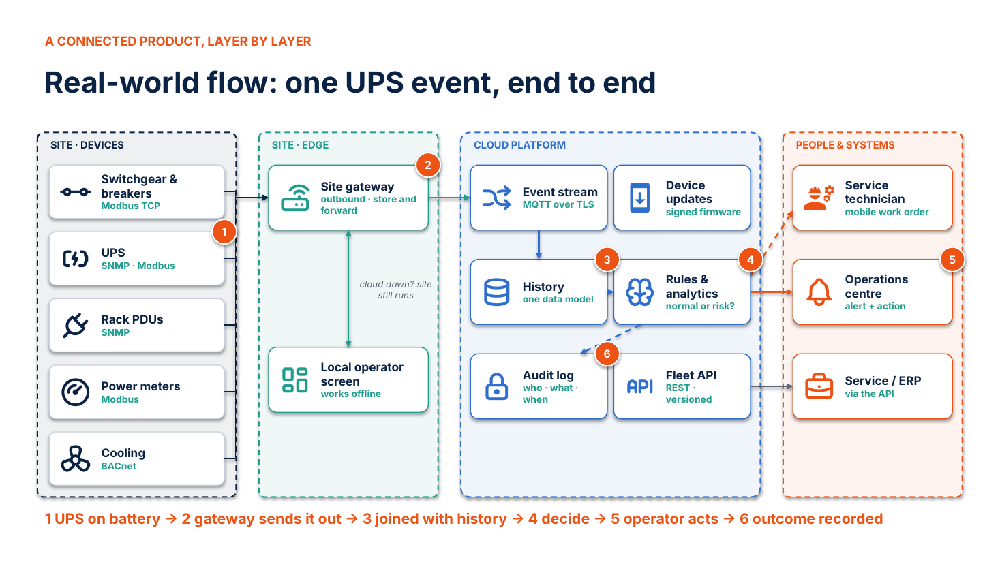
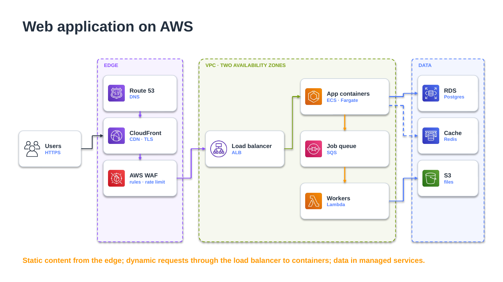
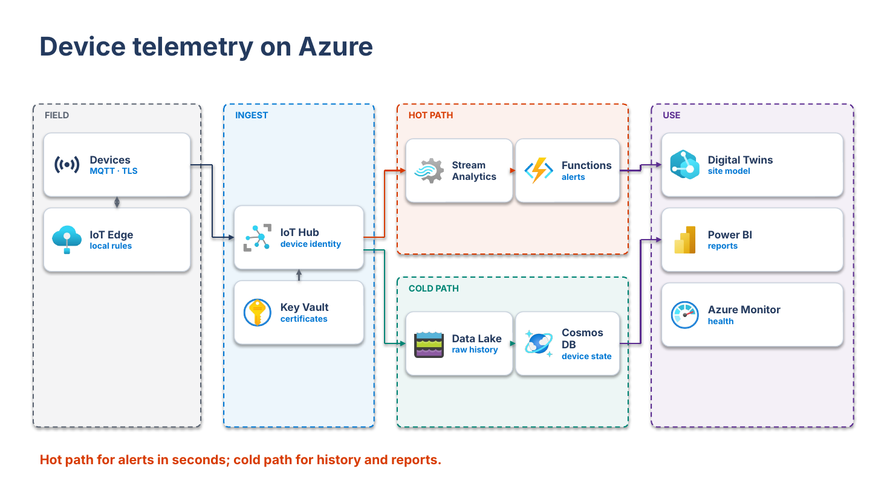
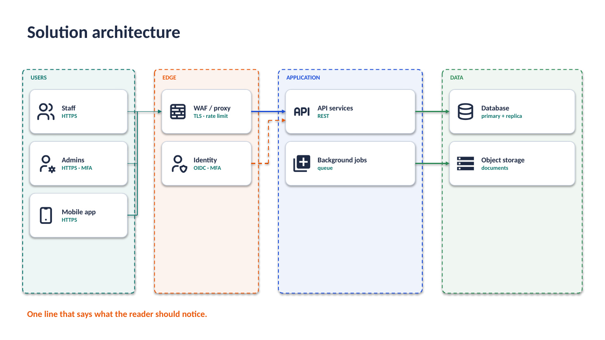

# archdiagrams

**Editable architecture diagrams for PowerPoint.** Zones, icon cards, arrows and numbered step badges, drawn as
native shapes from a short YAML file (or Python). Nothing is a picture: open the deck and change any box, label or
arrow by hand.



* **Looks hand-made, not generated.** Dashed rounded zones, white cards with an icon, a bold name and a small
  coloured protocol line, coloured arrows, step badges.
* **Icons for any audience, all included.** About 150 general icons (people, devices, cloud, data, security, energy,
  industrial IoT) that recolour to your theme, plus about 2,450 provider icons for **AWS (525), Azure (808), GCP (123),
  Kubernetes, on-prem, SaaS, IBM, OCI, Alibaba Cloud** and more. Nothing extra to install.
* **Fits any deck.** A diagram has its own canvas and scales into any box on any slide: a new deck, a new slide from
  your company template, or an existing slide.
* **Arrows that connect by name.** `ups.r → gateway.l`, with right-angle routing, labels, dashed and two-way lines,
  and a "bus" for many-to-one.
* **Checks itself.** Warns about overlapping cards, text that will not fit, and arrow labels with no room.

| AWS | Azure | General |
|---|---|---|
|  |  |  |

## Install

```bash
pip install "git+https://github.com/prashant-baj/pptx-archdiagrams"
# or, from a clone:
pip install -e .
```

All icons come with the package (about 6 MB). PNG previews need LibreOffice (`soffice`) and, ideally, poppler (`pdftoppm`).

## Quick start

```bash
archdiagrams new my-diagram.yaml --kind tiers        # starter: tiers | flow | compare
archdiagrams render my-diagram.yaml -o my-diagram.pptx --png
```

A spec:

```yaml
theme: default            # default | navy | aws | azure | mono | path/to/theme.yaml
size: [14, 5.6]           # the diagram's own canvas, in inches; all coordinates below use it
slide:                    # optional text around the diagram
  eyebrow: Part 4 · Flow
  title: One UPS event, end to end
  caption: 1 UPS on battery → 2 gateway → 3 history
  notes: Speaker notes.
elements:
  - zone: {id: site, at: [0, 0, 3, 5.6], label: Site, color: navy,
           cards: [{id: ups, icon: ups, title: UPS, sub: SNMP},
                   {id: mtr, icon: meter, title: Meters, sub: Modbus}]}
  - card: {id: gw, at: [3.5, 0.5, 2.5, 1], icon: gateway, title: Site gateway, sub: store and forward, color: teal}
  - card: {id: db, at: [7, 0.5, 2.5, 1], icon: aws/rds, title: History, sub: RDS · Postgres, color: blue}
  - bus:   {from: [ups, mtr], to: gw, color: navy}
  - arrow: {from: gw.r, to: db.l, color: teal, label: events}
  - badges: [[ups, 1], [gw, 2], [db, 3]]
```

## Using it with an existing deck

```bash
# a new deck that uses your template's masters and layouts
archdiagrams render a.yaml b.yaml -o out.pptx --template company.pptx --layout "Title Only"

# add a new slide to a deck (title goes in the layout's title placeholder)
archdiagrams add a.yaml --deck deck.pptx --layout "Title Only" -o deck-v2.pptx

# draw onto slide 7 of a deck, inside a box (x,y,w,h in inches)
archdiagrams add a.yaml --deck deck.pptx --slide 7 --box 0.9,2.3,14.2,5.6 -o deck-v2.pptx
```

From Python, draw onto any python-pptx slide:

```python
from archdiagrams import Diagram
d = Diagram(slide, size=(12, 4), box=(0.6, 1.5, 12.1, 5.0), theme='aws')
d.card('api', 0, 0, 3, 1, 'aws/lambda', 'Orders API', 'REST')
d.card('db', 5, 0, 3, 1, 'aws/dynamodb', 'Orders', 'DynamoDB')
d.arrow('api.r', 'db.l', label='write')
```

See [`examples/python_api.py`](examples/python_api.py).

## Spec reference

All positions and sizes are in inches inside the diagram's `size`. Colours are theme roles (`navy`, `blue`, `teal`,
`green`, `orange`, `red`, `purple`, `amber`, `grey`) or hex (`"0A7C59"`); `pale-<role>` gives the zone tint.

| Element | Keys |
|---|---|
| `zone` | `id, at: [x,y,w,h], label, color, dashed, fill` · optional `cards: [...]` laid out in a grid with `cols, card_h, max_card_h, gap, pad, align: top\|middle\|bottom\|spread, card_defaults` |
| `card` | `id, at, icon, title, sub, color` (border and icon tint) `, icon_color, emphasis, sub_color, title_size, sub_size, fill` |
| `arrow` | `from, to` as `id.side[@frac]` (sides `l r t b c tl tr bl br`) or `[x, y]` · `color, dashed, both, head, width, label, label_at, label_w, route: auto\|straight\|hvh\|vhv\|hv\|vh, via: [[x,y],...]` |
| `bus` | `from: [ids], to, color, side: r\|l\|t\|b, gap, label` many-to-one through a shared line |
| `badge` / `badges` | `{on: id, n: 1, corner: tr, color}` or `[[id, n], ...]` |
| `bar` | `id, at, text, color, text_color, size` a solid band with one line of bold text |
| `note` | `at: [x,y,w] or [x,y,w,h], text, color, size, bold, italic, align` |

Multiple diagrams in one file: put them under `slides:`; top-level keys (theme, size) are shared.

## Icons

```bash
archdiagrams icons ups                 # search
archdiagrams icons general/            # the whole general pack (trailing / = starts with)
archdiagrams icons aws/database/       # one AWS category
archdiagrams icons azure/iot/ --sheet azure-iot.png   # contact sheet
```

Reference icons as `ups` (general), `aws/compute/ec2` or just `aws/ec2`, `azure/iot-hub`, `gcp/bigquery`,
`k8s/pod`, `onprem/postgresql`, or a path to your own PNG. General icons take the card's colour; provider icons keep
their brand colours. All general icons: [docs/icons-general.png](docs/icons-general.png).

To add general icons, edit `tools/build_general_icons.mjs` and run it (`cd tools && npm install && node build_general_icons.mjs`).
To refresh the provider icons from a newer `diagrams` release: `pip install diagrams && python tools/build_provider_icons.py`.
To use your own provider icon folder instead, set `ARCHDIAGRAMS_PROVIDER_ICONS` to it (same `aws/compute/ec2.png` layout).

## Themes

`archdiagrams themes` lists them. A theme file:

```yaml
base: default
font: Segoe UI
colors: {navy: "1B2A4A", orange: "F26B21", brand: "00A3AD"}
sub: brand          # colour of the small line under card titles
```

## Design tips

* Read left to right: who uses it → edge → application → data / external. One zone per tier, 2–5 cards per zone.
* Keep card titles to 1–3 words and put the protocol or detail in `sub`.
* Colour by role, not decoration: one colour per zone, arrows in the colour of where they go.
* Use badges only for a real sequence, and repeat the sequence in the caption.
* Leave at least 0.8 in between zones where an arrow has a label.
* Always look at the PNG (`--png`) before sharing; fix any warning the tool prints.

## Licences

Code: MIT. General icons: [Tabler Icons](https://tabler.io/icons) (MIT) and [Material Design Icons](https://fonts.google.com/icons)
(Apache 2.0), via react-icons. Provider icons: taken from the [`diagrams`](https://github.com/mingrammer/diagrams)
project (MIT) and resized for slides; they remain trademarks of their owners (AWS, Microsoft, Google, CNCF...).
Use them to depict those services, and follow each provider's architecture-icon guidelines when you publish
diagrams. See [NOTICE](NOTICE).
